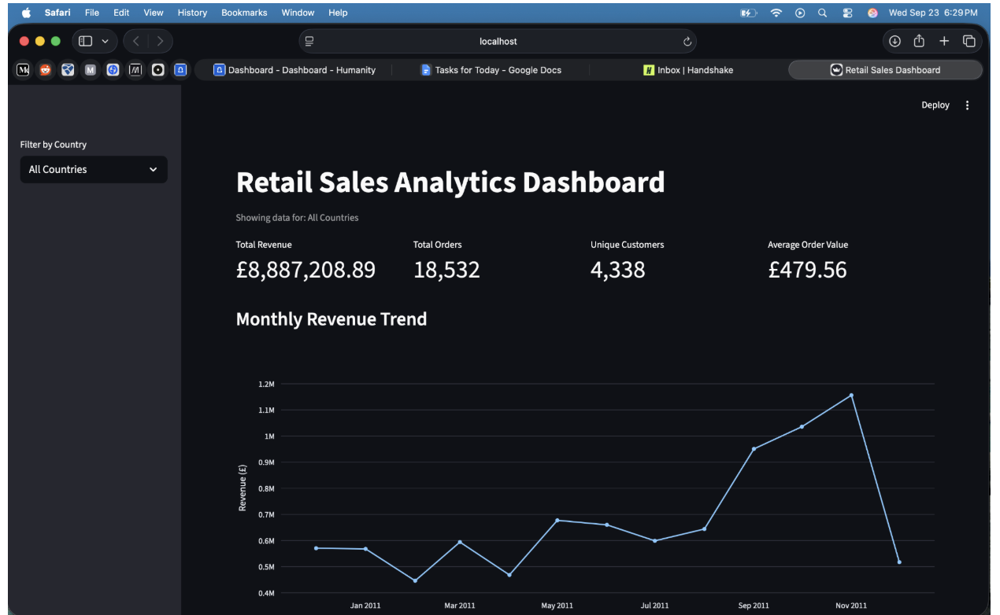

# Retail Sales ETL & Analytics Dashboard



**[Open the Streamlit dashboard](https://angel-retail-sales-analytics.streamlit.app/)** · Historical sample data, not live retail sales

An end-to-end retail analytics project: **Excel → Python ETL → cleaned transactions → MySQL / portable SQLite → SQL queries → Streamlit & Plotly dashboard**.

## What it demonstrates

- Extraction and cleaning using Python and Pandas
- Removal of null customer/description rows, duplicate transactions, cancellations, and invalid quantities/prices
- SQL analytics: revenue, orders, unique customers, average order value, trends, top products/countries/customers, and revenue by weekday
- Country filtering, interactive Plotly charts and Streamlit KPI cards
- An original MySQL ingestion pipeline, plus a portable **SQLite snapshot for reliable public hosting**

## Hosting architecture

The deployed Streamlit dashboard reads a compressed SQLite snapshot in `data/retail_sales.sqlite.gz`, unpacked locally when the app boots. **No paid external database, database credentials, or always-on Aiven instance is required.**

If the archive has not been generated yet, the dashboard can automatically download and build the data on first launch. This is a slower fallback, so use the GitHub Action below to commit a ready-made snapshot once.

## Deploy (one-time setup)

1. Add the changed files from `retail_dashboard_fix.zip` into this repository while preserving their paths (including `.github/workflows/build-snapshot.yml`).
2. Open **Actions → Build Retail Snapshot → Run workflow**, selecting the `main` branch. This downloads and cleans the public UCI dataset, writes the compressed SQLite database, and commits `data/retail_sales.sqlite.gz`.
3. In [Streamlit Community Cloud](https://share.streamlit.io/), use this GitHub repository, branch `main`, and **main file path `dashboard/app.py`**. If the app already exists, reboot it after the commit is visible.
4. Open the app and test country filtering and the charts. **No `DB_HOST`, `DB_PORT`, or other secrets are required for the public dashboard.**

If Actions cannot commit to the repository, check **Settings → Actions → General → Workflow permissions → Read and write permissions**. Alternatively, run the build command locally and upload the generated `data/retail_sales.sqlite.gz` to GitHub.

### Local development

```bash
python -m pip install -r requirements.txt
python src/build_snapshot.py --output data/retail_sales.sqlite.gz
streamlit run dashboard/app.py
```

To build from an existing source workbook instead of downloading it:

```bash
python src/build_snapshot.py --source 'data/raw/Online Retail.xlsx' --output data/retail_sales.sqlite.gz
```

The older MySQL ETL scripts remain in `src/extract.py`, `src/transform.py`, and `src/load.py`. They are **not** executed on Streamlit Cloud. For the MySQL workflow, configure credentials privately in a local `.env` file and run those scripts separately.

## Repo structure

```text
retail-sales-analytics/
├── .github/workflows/build-snapshot.yml  # One-click public dataset build
├── assets/dashboard.png                  # Screenshot of original dashboard
├── dashboard/app.py                      # Hosted SQLite dashboard
├── data/retail_sales.sqlite.gz           # Generated by GitHub Action (not secrets)
├── sql/analysis.sql                      # Original MySQL SQL exercises
├── src/extract.py                        # Original Excel extraction
├── src/transform.py                      # Original data cleaning
├── src/load.py                           # Original MySQL load
├── src/build_snapshot.py                 # Portable data builder
├── requirements.txt
└── README.md
```

## Dataset and license

Source: **Chen, D. (2015). Online Retail**, UCI Machine Learning Repository, DOI [10.24432/C5BW33](https://doi.org/10.24432/C5BW33). Source is available under **CC BY 4.0**. It covers historical transactions from a UK online retailer between December 2010 and December 2011. The analytics deliberately exclude canceled/returned sales and transactions without known customers or descriptions; revenue is in GBP.
